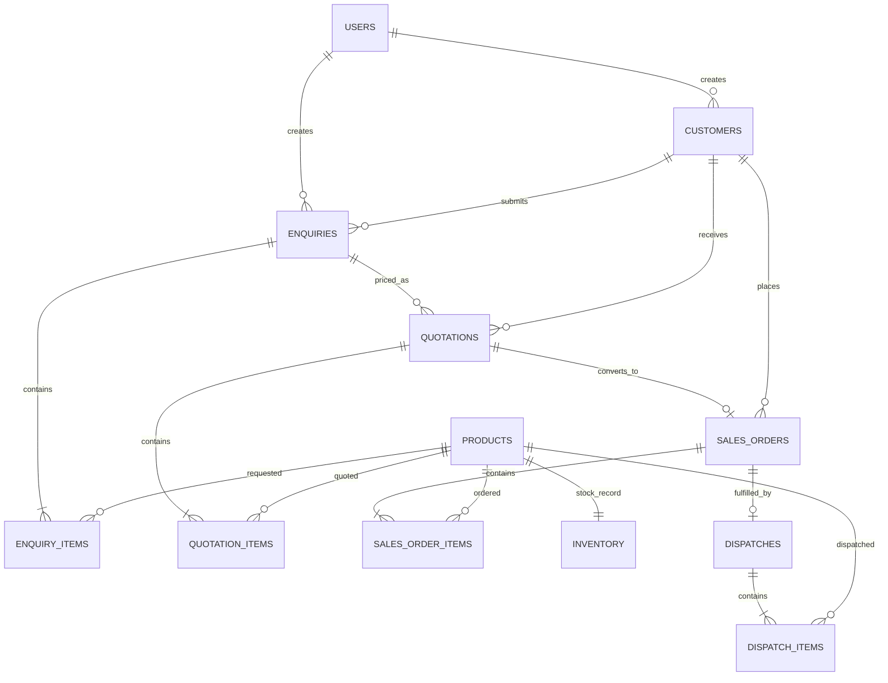

# Relational model (ER diagram)

Key integrity controls:
- Unique product code, enquiry number, quotation number, order number and dispatch number.
- `sales_orders.quotation_id UNIQUE` means one quotation can create at most one order.
- Inventory checks ensure physical and reserved quantities are non-negative and reserved does not exceed physical.
- Item quantities must be positive; discounts and GST percentages are constrained to 0–100.
- Stock changes and workflow status changes occur in transactions.
